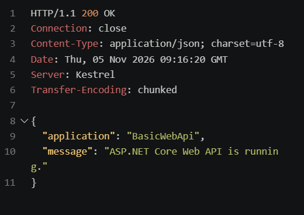
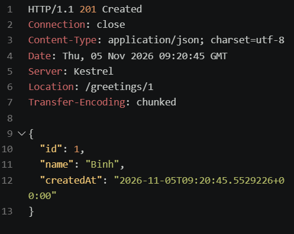
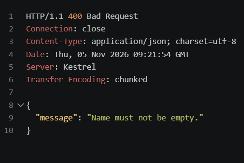
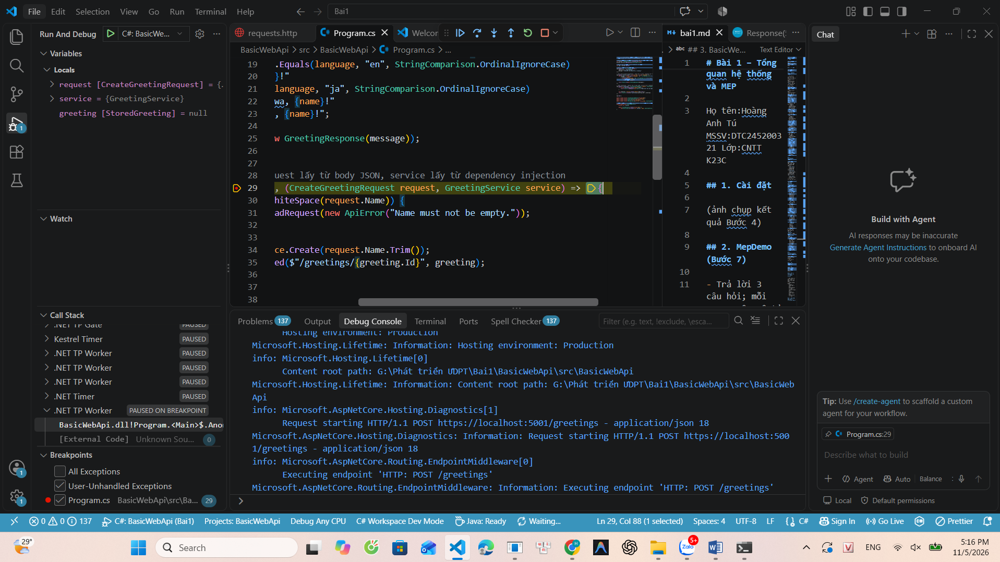

# Bài 1 – Tổng quan hệ thống và MEP

Họ tên:Hoàng Anh Tú MSSV:DTC245200321 Lớp:CNTT K23C

## 1. Cài đặt

(ảnh chụp kết quả Bước 4)

## 2. MepDemo (Bước 7)

- Trả lời 3 câu hỏi; mỗi MEP 1 câu mô tả
- **Câu 1:** Ở MEP 3 (Queue-based), mỗi bài nộp `sub-x` chỉ do **1 worker** xử lý (các worker chia nhau nhận công việc từ hàng chờ).
- **Câu 2:** Ở MEP 4 (Publish-Subscribe), một sự kiện phát đi sẽ được gửi tới **cả 3 dịch vụ** (tất cả các dịch vụ đăng ký nhận tin đều nhận được).
- **Câu 3 - Mô tả 5 MEP:**
  - **MEP 1 (Request-Response):** Bên gửi (Client) phát yêu cầu và tạm dừng chờ bên nhận (Server) xử lý rồi trả kết quả phản hồi.
  - **MEP 2 (One-Way / Fire-and-Forget):** Bên gửi chỉ phát thông điệp đi mà không chờ nhận lại phản hồi.
  - **MEP 3 (Queue-Based):** Thông điệp đưa vào hàng chờ để các Worker chia nhau lấy ra xử lý độc lập.
  - **MEP 4 (Publish-Subscribe):** Một sự kiện phát đi từ nhà phát hành sẽ được truyền đồng thời tới tất cả dịch vụ đã đăng ký.
  - **MEP 5 (Streaming):** Dữ liệu được truyền liên tục theo dạng dòng dữ liệu (stream) giữa 2 bên.

## 3. BasicWebApi (Bước 8)

- Ảnh chụp REST Client: 200, 201, 400
- **HTTP 200 (OK):**
  
- **HTTP 201 (Created):**
  
- **HTTP 400 (Bad Request):**
  
- Trả lời 3 câu hỏi mục 8.4

1. **Dòng `builder.Services.AddSingleton...` phải đứng trước `builder.Build()`:**
   - **Giải thích:** Cần khai báo và đăng ký tất cả dịch vụ vào Dependency Injection container trước khi khởi tạo ứng dụng `app`. Nếu gọi sau khi `Build()`, hệ thống sẽ báo lỗi runtime vì container không thể thay đổi thêm.
2. **Nguồn gốc tham số trong `/hello/{name}?language=en`:**
   - Tham số `name` lấy từ **Route parameter** (đường dẫn URL).
   - Tham số `language` lấy từ **Query string** (sau dấu `?` trên URL).
3. **Vì sao POST hợp lệ trả về `Results.Created` (201) thay vì `Results.Ok` (200):**
   - Theo chuẩn thiết kế RESTful API, mã HTTP **201 Created** thể hiện một tài nguyên mới vừa được khởi tạo thành công trên server.
     --Trả lời phần 8.6
     

## 4. MiniDistributedSystem (Bước 9)

- Ảnh chụp 2 terminal API + Client
- Trả lời 3 câu hỏi

## 5. Thí nghiệm lỗi (Bước 10)

| # | Dự đoán | Thực tế | Đúng/Sai | Giải thích |

## 6. Dự án EduSubmit tự làm (Bước 11-12)

- Ảnh chụp kết quả; phần nào phải xem code mẫu?
- Luồng thông điệp:
  Client --(HTTP GET /api/assignments)--> Api : request-response
  Client --(HTTP POST /api/submissions)--> Api : ...

## 7. Khó khăn gặp phải và cách giải quyết
